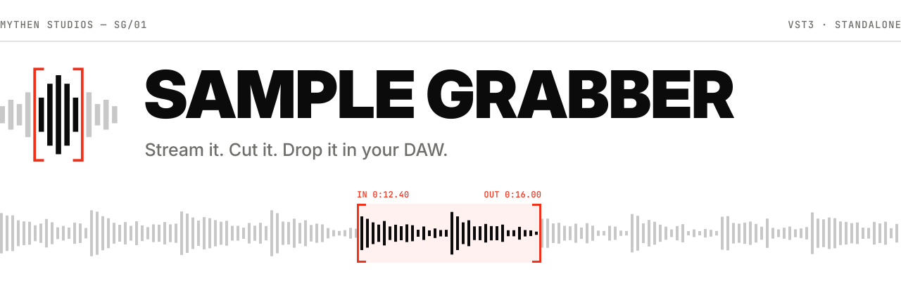
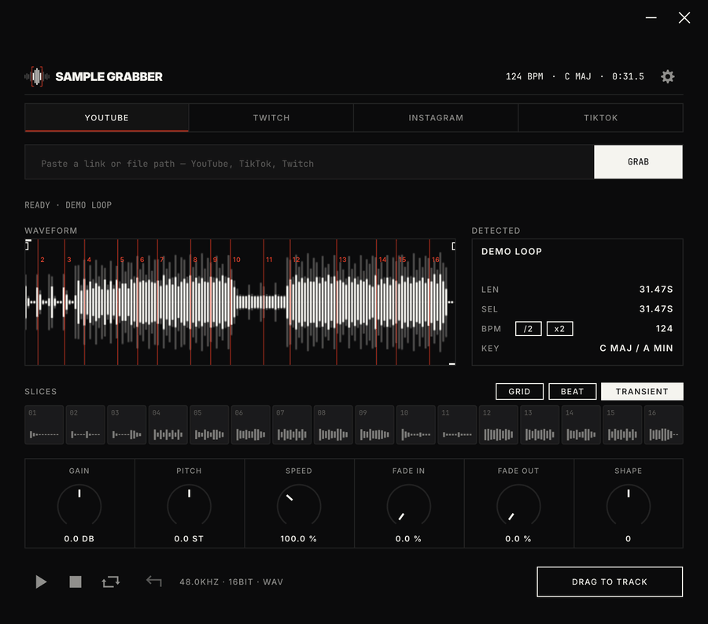
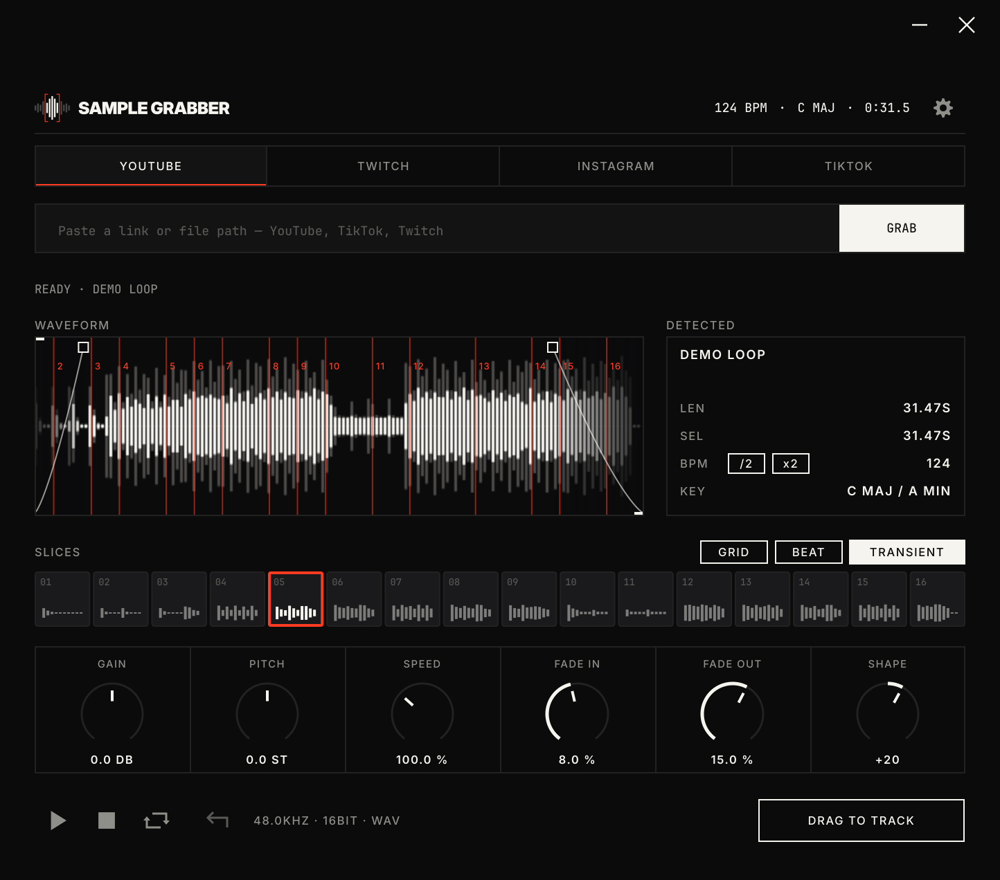
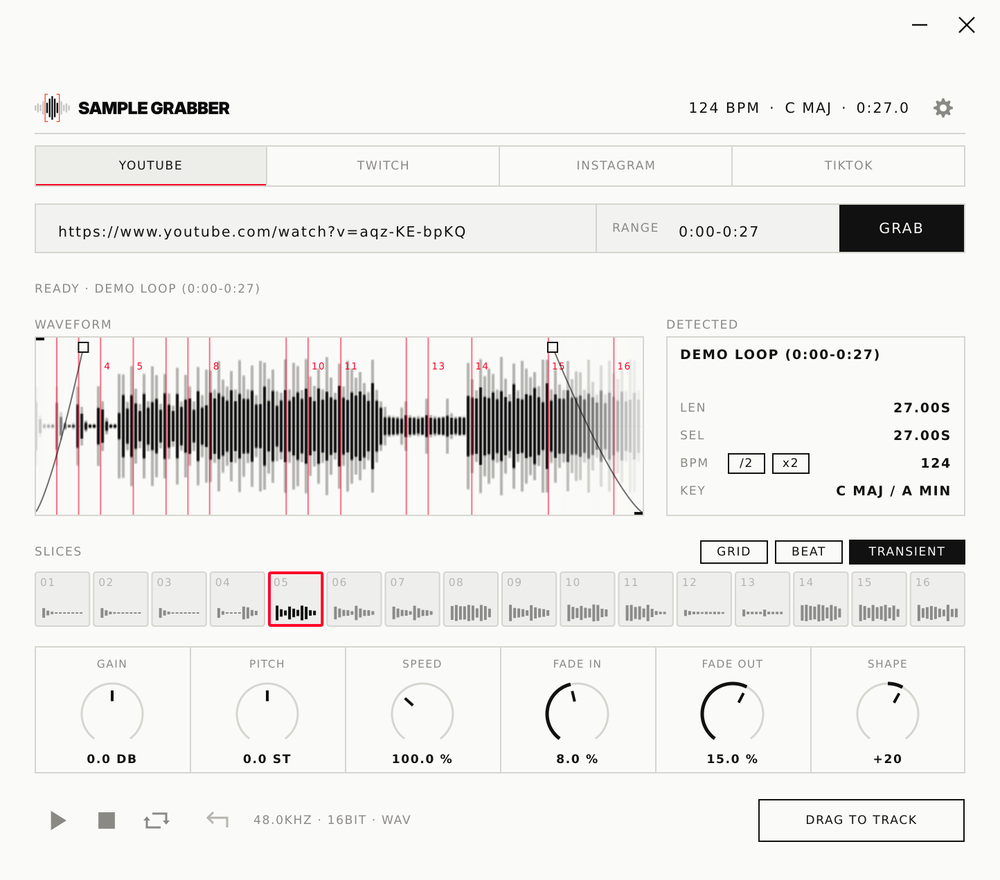
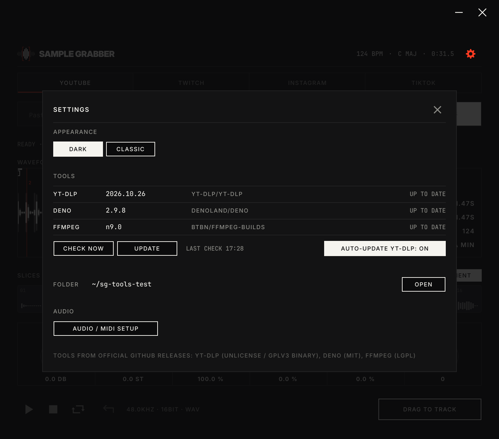
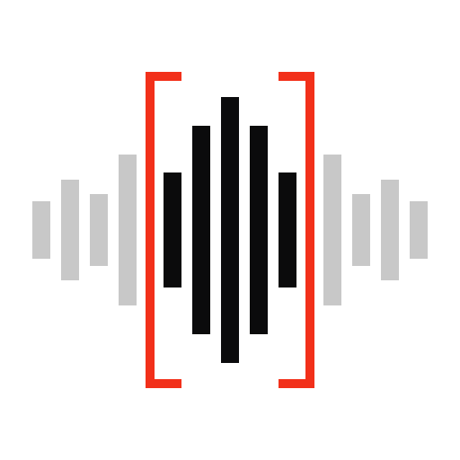

<p align="center">
  <picture>
    <source media="(prefers-color-scheme: dark)" srcset=".github/assets/banner-dark.svg">
    <source media="(prefers-color-scheme: light)" srcset=".github/assets/banner-light.svg">
    
  </picture>
</p>

<p align="center">
  <b>Pull audio from a link or a file, cut exactly the part you need,<br>slice it across 16 pads and drag it straight into your DAW.</b>
</p>

<p align="center">
  <sub>by Mythen Studios</sub>
</p>

<p align="center">
  <a href="https://isocpp.org"></a>
  <a href="https://juce.com"></a>
  <a href="#install-windows"></a>
  <a href="#install-windows"></a>
  <a href="#status"></a>
</p>
<p align="center">
  <a href="LICENSE"></a>
  <a href="https://github.com/mythenstudios/sample-grabber/stargazers"></a>
  <a href="https://ko-fi.com/mythenstudios"></a>
</p>

<p align="center">
  
</p>

## What it does

| | |
|---|---|
| **Grab** | Paste a YouTube, TikTok, Instagram or Twitch link, a local file path, or drop a file onto the window (WAV, MP3, M4A, Opus, video ...). Grab only a part with a time range (`1:02-1:30`, or `t=` in the link); long downloads can be cancelled. |
| **Trim** | Waveform with in/out handles, zoom, loop and instant playback. |
| **Slice** | Auto-slice the selection across 16 pads: **Grid**, **Beat** or **Transient**. Pads respond to clicks and MIDI notes 36-51. |
| **Analyse** | BPM and key estimate on the whole track or the current selection, with tempo octave `/2` `x2`. A starting point, not a verdict - see [Accuracy](#accuracy). |
| **Shape** | Gain, pitch and speed (independent, applied live), fade in/out with adjustable curve, drawn right in the waveform. |
| **Drop** | Drag a pad or the whole selection into your DAW as a WAV file (saved under `Music/Sample Grabber`, folder changeable in the settings). |
| **Recall** | The plugin state is saved with your DAW project, including the selected audio - it still plays if the download is gone. |
| **Tools** | yt-dlp, deno and ffmpeg are installed and kept up to date by the app itself - from their official GitHub releases, SHA-256 verified. No Python, no PATH setup. One click removes them again. |

<p align="center">
  
  
</p>
<p align="center"><sub>Two themes: <b>Dark</b> and <b>Classic</b>.</sub></p>

## Accuracy

BPM, key and the **Beat** / **Transient** slicing are automatic estimates. They are right for most
straight-ahead tracks, but they will be wrong sometimes - trust your ears over the numbers:

- **Tempo** can come out at half or double speed (e.g. 87 instead of 174), especially with half-time drums,
  swing or very sparse intros. Use `/2` and `x2`, or analyse a busier part of the track by selecting it.
- **Key** is shown as the minor key and its relative major (`A MIN / C MAJ`) because both share the same notes.
  Modal music, strong key changes, atonal parts or heavy detuning can give the wrong result.
- **Live recordings** with drifting tempo, rubato or tempo changes only get an average tempo.
- **Slices** follow the detected beats or transients; check the pads and nudge the selection if a cut lands early or late.

Detection runs only on your machine and uses openly documented methods (no proprietary or GPL analysis libraries).

## Status

Early development. Expect rough edges and breaking changes between commits.

| Platform | State |
|---|---|
| Windows 10/11 x64 | Works. Installer, tested in FL Studio and Ableton Live on Windows 11 |
| Linux x86_64 | Works. Built on Ubuntu 22.04 (glibc 2.35), tested on Ubuntu 26.04 in Ardour, Reaper and Bitwig |
| Windows ARM64, Linux ARM64 | Planned |
| macOS (Apple Silicon) | Planned |

Known limitations on Linux: in Bitwig, dropping a file *onto the plugin window* does not reach the plugin
(Bitwig keeps the drop) - paste the file path into the link field instead. Dragging pads *out* works everywhere.

## Install (Windows)

Download `SampleGrabber-<version>-windows-x64-setup.exe` and run it.

- The installer is not code-signed yet, so Windows SmartScreen warns on first start:
  **More info** -> **Run anyway**.
- **All users** puts the plugin into `C:\Program Files\Common Files\VST3`, the folder every DAW scans (asks for admin rights).
  **Only me** needs no admin rights, but you may have to add `%LOCALAPPDATA%\Programs\Common\VST3` to your DAW's plugin folders.
- **Recommended** uses the standard folders; **Advanced** lets you choose components and the plugin, export and cache folders.
  The summary page shows what goes where, and `INSTALLED-FILES.txt` next to the app lists it again.
- Uninstall via *Settings -> Apps*. It removes plugin, app, tools, cache and settings; your exported samples stay unless you choose to delete them.

Rescan plugins in your DAW if it does not show up (close the DAW while installing).

## Install (Linux)

Download `sample-grabber-<version>-linux-x86_64.tar.gz`, unpack it and run:

```bash
./install.sh      # VST3 to ~/.vst3, app to ~/.local/bin + app menu entry, no root needed
./uninstall.sh    # removes it again (add --purge to also delete settings, tools and cache)
```

Rescan plugins in your DAW if it does not show up. More notes in [`packaging/linux/README.txt`](packaging/linux/README.txt).

## Build (Linux)

Requirements: CMake 3.22+, a C++17 compiler, Ninja, and the usual JUCE dependencies.
JUCE 8.0.4 and [signalsmith-stretch](https://github.com/Signalsmith-Audio/signalsmith-stretch) are fetched automatically by CMake.

```bash
sudo apt install build-essential cmake ninja-build git pkg-config curl xz-utils \
  libasound2-dev libjack-jackd2-dev libfreetype-dev libfontconfig1-dev \
  libx11-dev libxcomposite-dev libxcursor-dev libxext-dev libxinerama-dev \
  libxrandr-dev libxrender-dev libglu1-mesa-dev mesa-common-dev

cmake -B build -G Ninja -DCMAKE_BUILD_TYPE=Release
cmake --build build
```

Artefacts:

- Standalone: `build/SampleGrabberApp_artefacts/Release/Sample Grabber`
- VST3: `build/SampleGrabber_artefacts/Release/VST3/Sample Grabber.vst3`

On first start the app offers **INSTALL TOOLS** (yt-dlp, deno, ffmpeg - about 220 MB on Linux, 385 MB on Windows).
They go to `~/.config/SampleGrabber/bin` (Windows: `%LOCALAPPDATA%\SampleGrabber\bin`) and are managed
from the settings (gear icon, top right), together with the cache and export folders.
At runtime Linux needs `curl`, `tar` and `xz`.

`bash scripts/package-linux.sh` builds the release tarball into `dist/`.

Developing in WSL2? `scripts/setup-wsl.sh` installs the build dependencies, `scripts/wsl-audio.sh` routes ALSA to WSLg's PulseAudio.

## Build (Windows)

Requirements: Visual Studio 2022 (Desktop development with C++), CMake 3.22+, Git.
Optional: [Inno Setup 6.7+](https://jrsoftware.org/isinfo.php) for the installer.

```powershell
cmake -S . -B build -G "Visual Studio 17 2022" -A x64
cmake --build build --config Release --target SampleGrabber_VST3 SampleGrabberApp
```

The installer is built from `installer/SampleGrabber.iss` (see the comment at its top); CI does this on every push.

<p align="center">
  
</p>

## Third-party software

| Component | Use | License |
|---|---|---|
| [JUCE](https://juce.com) | Framework | AGPLv3 / commercial |
| [signalsmith-stretch](https://github.com/Signalsmith-Audio/signalsmith-stretch) | Pitch / time stretching | MIT |
| [Inter](https://rsms.me/inter/), [JetBrains Mono](https://www.jetbrains.com/lp/mono/) | UI fonts (`resources/fonts`) | SIL OFL 1.1 |
| [yt-dlp](https://github.com/yt-dlp/yt-dlp) | Downloading (separate process, downloaded at runtime) | Unlicense; release binaries include GPLv3+ code |
| [deno](https://github.com/denoland/deno) | JavaScript runtime for yt-dlp (YouTube) | MIT |
| [Inno Setup](https://jrsoftware.org/isinfo.php) | Windows installer (build tool, not part of the app) | Inno Setup License |
| [FFmpeg](https://ffmpeg.org) ([BtbN builds](https://github.com/BtbN/FFmpeg-Builds), LGPL variant) | Decoding / conversion (separate process) | LGPL 2.1+ |

The external tools are never bundled with Sample Grabber. They are downloaded by the user's machine from their official releases and run as separate programs.

## Responsible use

Sample Grabber is a tool. You are responsible for having the rights to the audio you download, sample and release, and for following each platform's terms of service.

## Support

Sample Grabber is free and stays free. If it saves you time, you can buy us a coffee - it helps keep the project maintained.

<a href="https://ko-fi.com/mythenstudios">
  <picture>
    <source media="(prefers-color-scheme: dark)" srcset=".github/assets/kofi-dark.svg">
    
  </picture>
</a>

## License

Sample Grabber is free software, licensed under the [GNU Affero General Public License v3.0](LICENSE) (AGPL-3.0-or-later).

Copyright (C) 2026 Mythen Studios <hello@mythenstudios.com>

**What this means for forks and redistribution:** you may use, study, change and share Sample Grabber.
If you distribute a modified version, or offer it to users over a network, you must release its complete
source code under the same license (AGPL-3.0-or-later) and keep the copyright notices. Closed-source,
paywalled or subscription-only versions of this code are not allowed.

The names "Sample Grabber" and "Mythen Studios" and the logos are not covered by the code license.
Forks must use their own name and branding, see [TRADEMARKS.md](TRADEMARKS.md).

Third-party components keep their own licenses (see the table above).

<picture>
  <source media="(prefers-color-scheme: dark)" srcset=".github/assets/divider-dark.svg">
  
</picture>

<p align="center">
  <picture>
    <source media="(prefers-color-scheme: dark)" srcset="brand/mark/mark-dark.svg">
    
  </picture>
  <br>
  <sub>Mythen Studios &mdash; made in Switzerland</sub>
</p>
